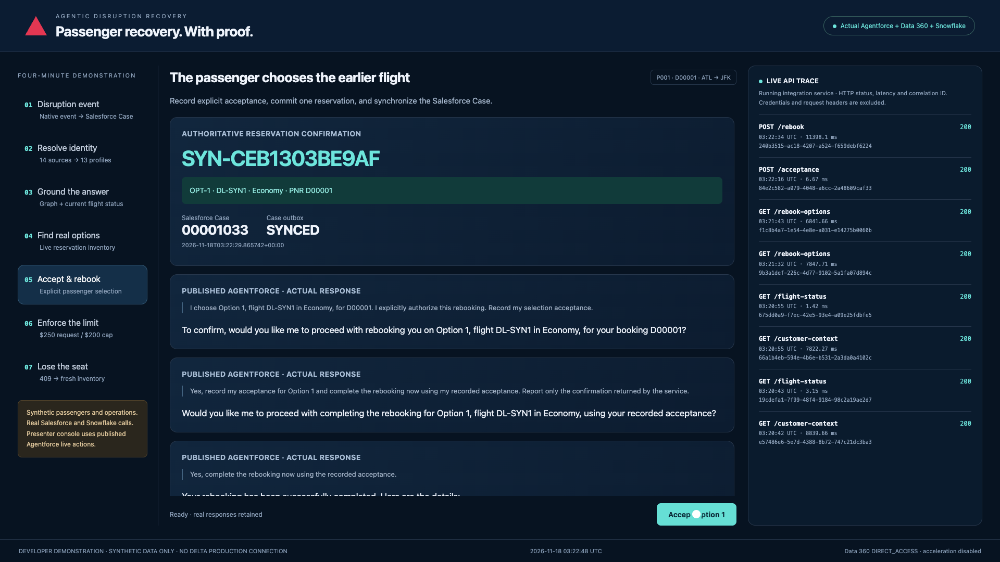
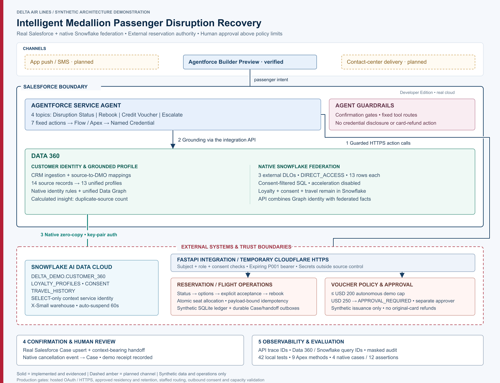

# Delta Agentic Disruption Recovery

From cancelled to confirmed in Minutes: delta-rebooking-1min-video


[](video/demo/delta-recovery-live-demo.mp4)

**[Watch the narrated demo](video/demo/delta-recovery-live-demo.mp4)** · [Execution evidence](video/demo/execution.json) · [Four-minute script](video/demo/script.md)

A cancelled flight should lead to a verified recovery, with the correct passenger, current inventory and a clear boundary for human approval.

This project demonstrates that journey using **Salesforce Agentforce, Data 360 and Snowflake**, connected to an executable synthetic reservation and voucher service. Salesforce and Snowflake calls are real. Passenger records, flight operations, bookings and voucher policies are synthetic demonstration data; this is not a Delta production system.

## Passenger Recovery Agent

The published `Delta_Medallion_Recovery` agent verifies passenger context, checks cancellation status, retrieves real options from the mock reservation API, records an explicit selection, and completes a reservation. Above-cap voucher requests require human approval. If a seat disappears, the service rejects the transaction and the agent must retrieve fresh inventory.

### Agent Details

- **Four topics:** disruption status, rebooking, credit vouchers and escalation.
- **Seven actions:** customer context, flight status, rebooking options, acceptance, rebooking, voucher request and handoff.
- **Execution:** Agentforce → Flow → Apex → Named Credential → FastAPI.
- **Identity:** native Data 360 resolution consolidates 14 source records into 13 profiles; conflicting loyalty identities remain separate.
- **Grounding:** a unified Data Graph verifies the fixed P001 pilot identity. The Data 360 Query API separately reads consent-filtered Snowflake context through native zero-copy federation.

### Agent Architecture



### Component Details

| Component | Responsibility |
| --- | --- |
| Salesforce Agentforce | Conversation, topic selection and fixed action invocation |
| Salesforce Data 360 | CRM ingestion, standard model mappings, native identity resolution, unified Data Graph, profile-count calculated insight and Query API |
| Snowflake | Loyalty, purpose-specific consent and travel history, exposed as three native `DIRECT_ACCESS` external DLOs with acceleration disabled |
| FastAPI reservation service | Authoritative synthetic flight status, inventory, acceptance, atomic rebooking and idempotency |
| Voucher service | $200 autonomous demonstration cap; approval proposal for a $250 request; separate human approver role |
| Salesforce Case | Confirmed booking synchronization and a context-bearing human-review record |
| Presenter console | Actual published Agentforce replies and live API traces, shown together for recording and inspection |

The external Snowflake DLOs are queried separately from the unified Graph; custom federated DMO and Graph relationships are not deployed. Live seat inventory stays in the reservation service.

## Setup and Installation

### Prerequisites

- Python 3.13 and Salesforce CLI (`sf`).
- An authorized Salesforce org with Agentforce and Data 360 enabled. This demo uses alias `delta-dev` and existing deployed synthetic source identifiers.
- For the native path, the existing Snowflake connector and three `DIRECT_ACCESS` streams described in the [federation runbook](docs/federation-decision.md).
- For recording: macOS `say`, Google Chrome, Node.js, and the Cloudflare `cloudflared` executable.

### Installation

```bash
git clone https://github.com/udhayapriya1/delta-agentic-disruption-recovery.git
cd delta-agentic-disruption-recovery
./scripts/setup.sh
```

Authenticate the intended Salesforce org:

```bash
sf org login web --alias delta-dev
```

The deployment assets target the existing demo org. A new org requires provisioning the native data resources and agent, then updating the source IDs in `delta_demo/salesforce.py`. See [deployment instructions](docs/deployment-guide.md) and the [Data 360 mappings](docs/data360/logical-model-and-mappings.md).

## Running the Integration Service

```bash
export DELTA_JWT_SECRET="$(.venv/bin/python -c 'import secrets; print(secrets.token_urlsafe(48))')"
export DELTA_CONTEXT_MODE=data360_federation
export DELTA_SALESFORCE_ORG=delta-dev
export DELTA_SALESFORCE_SYNC=true
export DELTA_DATA360_REST_GRAPH=true
export DELTA_DATA360_UNIFIED_GRAPH=true
./scripts/run-api.sh
```

Open [the API documentation](http://127.0.0.1:8000/docs). In another terminal with the same secret, issue a short-lived local passenger token:

```bash
.venv/bin/python -m scripts.issue_test_token --subject P001
```

Use it as the bearer credential when calling the API. Keep credentials out of source control, screenshots and logs. `.env.example` lists supported settings; the service expects exported environment variables and does not automatically load `.env`.

### Running the Agent

Open the published **Delta Medallion Recovery** agent in Agentforce Builder and start Preview. Its Named Credential must point to the running service and contain a matching unexpired P001 token. [Conversation prompts](docs/live-agentforce-conversation.md) cover status, context, options, explicit acceptance, booking and voucher approval.

### Recording the Demo

The launcher creates fresh happy-path and failure ledgers, a P001-only 90-minute token, a temporary HTTPS tunnel, and updates the existing Salesforce Named Credential. Run it only in the authorized synthetic demonstration environment. It sends no outbound passenger message.

```bash
.venv/bin/python -m pip install -r requirements-media.txt
npm --prefix demo install
# Install cloudflared separately; make it available on PATH.
.venv/bin/python scripts/start_recording_demo.py
```

Open [the private presenter console](http://127.0.0.1:8765). In a second terminal:

```bash
node scripts/record_demo.mjs
.venv/bin/python scripts/verify_recording.py
.venv/bin/python scripts/render_demo.py
```

The recorder executes the published agent's live actions and captures the running browser. The renderer produces a four-minute 1080p video, spoken narration, burned captions, selectable subtitles and chapter markers. Cloud waits are shortened and labeled. Raw recordings and credentials stay in ignored `tmp/recording/`; reviewed execution evidence accompanies the final video.

The launcher refuses to overwrite an existing ledger. Archive `tmp/recording/` before a new run. Stop the launcher after recording to close the tunnel. The recording temporarily points the Named Credential at the isolated failure ledger for the final test; the launcher restores the happy-path endpoint when it shuts down.

## Validation

```bash
./scripts/run-tests.sh
.venv/bin/python scripts/verify_native_identity.py
.venv/bin/python scripts/verify_native_federation.py
```

Local tests cover authorization, consent, conflicting identity, current acceptance, idempotency, concurrent bookings, voucher approval, source failure and 409 recovery. Unit tests inject explicit fixtures; they do not establish cloud deployment success. Native verification scripts query the connected platform. Federation verification temporarily changes synthetic P012 miles and consent, then restores them.

## Demonstrated Boundaries

- The native disruption event subscriber creates a Case. Proactive outbound messaging and event-driven Data 360 refresh are not implemented.
- Native identity matching requires exact canonical verified email **and** loyalty identifier **and** surname. Native unmerge remains untested.
- Contact data is masked in the context response; payment data is not returned by this API.
- A human-review Case update does not establish staffed Omni-Channel delivery or human acknowledgement.
- Hosted Salesforce OAuth, managed secrets, retention/deletion controls and surge testing remain production work.

## Project Structure

```text
delta_demo/       Integration service, identity and cloud adapters
salesforce/       Active metadata and Data 360 configuration assets
snowflake/        Synthetic source schema and bootstrap SQL
data/             Synthetic passenger records and source mappings
demo/             Private live presenter console
scripts/          Setup, deployment, verification and recording tools
tests/            Automated behavior and adapter tests
architecture/     Current architecture diagram
video/demo/       Narrated recording, script, captions and fresh evidence
docs/             Deployment, data model, federation and security runbooks
```

Earlier architectures, migration plans, raw deployment iterations and presentation drafts are excluded from the demo check-in. The README structure follows the agent overview, architecture, components and setup flow of the [Harmony City Zoo agent example](https://github.com/lynnaloo/harmony-zoo-agent/blob/main/README.md).
